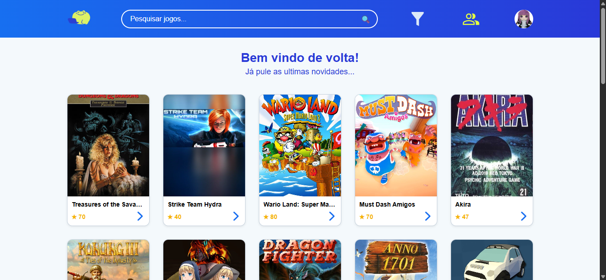
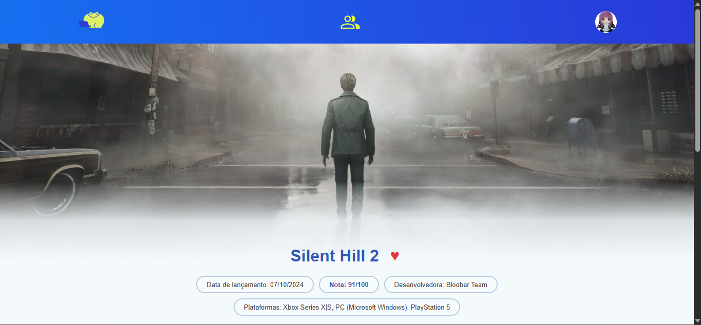
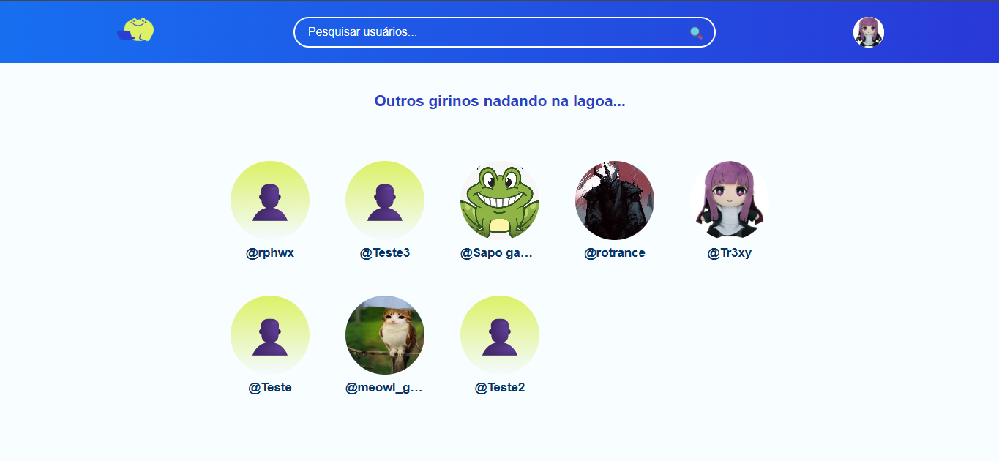
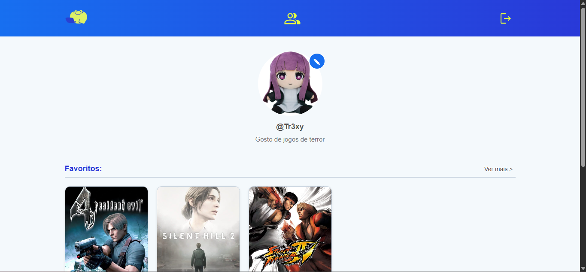
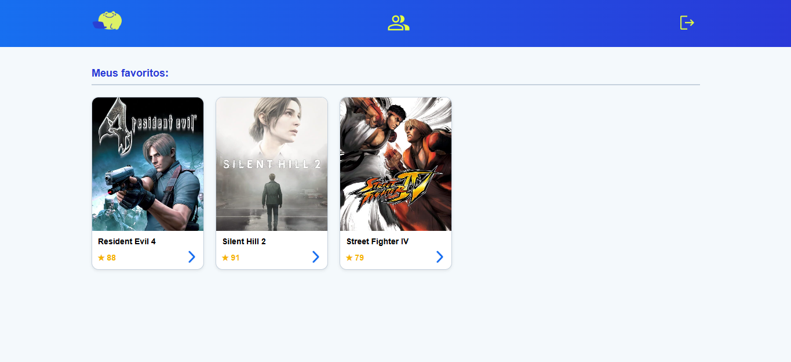
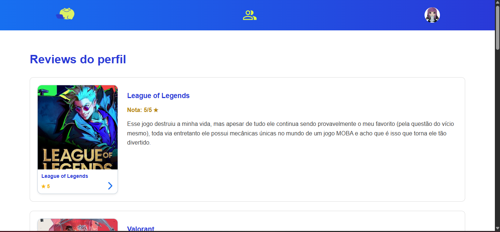

# GameHub

O **GameHub** é uma plataforma web para descoberta, pesquisa e avaliação de jogos. Os usuários podem pesquisar jogos, visualizar informações, adicionar favoritos e publicar avaliações.

O projeto utiliza **React, TypeScript, Node.js, Express, Firebase e IGDB**.

---

## Desenvolvedores

| Desenvolvedor | Matrícula |
|---|---|
| Dhallyson Breno Carvalho da Silva | 01797597 |
| Joanne Alexandrino Floriano de Oliveira | 01800675 |
| Raphael Pereira da Silva | 01797315 |
| Victor Davi Costa Amaral e Sousa | 01800467 |

As identificações acima seguem o README atual do projeto.

---

## Responsabilidades dos desenvolvedores

### Dhallyson

Responsável principalmente pela lógica de jogos, autenticação, perfil, avaliações e integração com os serviços.

**Pages**
- `Home.tsx`
- `jogos.tsx`
- `Perfil.tsx`

**Components**
- `ReviewForm.tsx`
- `ReviewList.tsx`

**Hooks**
- `useGames.ts`

**Context**
- `AuthContext.tsx`

**Services**
- `auth.ts`
- `favorites.ts`
- `firebase.ts`
- `profile.ts`
- `profileStorage.ts`
- `reviews.ts`

**Styles**
- `home.css`
- `game.css`
- `ComponentReviewForm.css`
- `ComponentReviewList.css`

---

### Victor

Responsável principalmente pela autenticação, cadastro, login, cabeçalho e componentes de formulário.

**Pages**
- `Cadastro.tsx`
- `Login.tsx`

**Components**
- `FormInput.tsx`
- `Header.tsx`

**Hooks**
- `useAuth.ts`

**Styles**
- `auth.css`
- `ComponentFormInput.css`
- `ComponentHeader.css`

---

### Joanne

Responsável principalmente pela área de usuários, perfis públicos e sistema de favoritos.

**Pages**
- `Usuarios.tsx`
- `PerfilUsuario.tsx`

**Components**
- `UserCard.tsx`
- `Profile.tsx`

**Hooks**
- `useFavorites.ts`

**Styles**
- `usuarios.css`
- `ComponentUserCard.css`
- `ComponentProfile.css`
- `profile.css`

---

### Raphael

Responsável principalmente pelas páginas de favoritos e reviews do perfil, cards de jogos e edição de perfil.

**Pages**
- `FavoritosPerfil.tsx`
- `ReviewsPerfil.tsx`

**Components**
- `GameCard.tsx`
- `ProfileEditModal.tsx`

**Hooks**
- `useReviews.ts`

**Styles**
- `ReviewsPerfil.css`
- `FavoritosPerfil.css`
- `ComponentGameCard.css`
- `ComponentProfileEditModal.css`

---

# Telas da aplicação

### Home



### Cadastro


### Página do jogo



### Usuários



### Perfil



### Favoritos



### Reviews



---

# Funcionalidades

- Cadastro e login de usuários.
- Edição de perfil.
- Foto e biografia do usuário.
- Visualização de outros usuários.
- Pesquisa de jogos.
- Filtros por gênero.
- Página de detalhes dos jogos.
- Sistema de favoritos.
- Sistema de avaliações.
- Perfil com favoritos e reviews.
- Integração com a API IGDB.
- Armazenamento de dados no Firebase Firestore.

A aplicação também possui filtros por gêneros como Ação, Terror, Aventura, RPG, Estratégia, Corrida, Esporte, Simulação, Puzzle e Sobrevivência.

---

# Tecnologias

### Frontend

- React
- TypeScript
- Vite
- React Router
- CSS

### Backend

- Node.js
- Express
- CORS
- dotenv

### Banco e autenticação

- Firebase Authentication
- Firebase Firestore
- Firebase Admin SDK

### API

- IGDB
- Twitch OAuth

### Armazenamento

- Cloudinary

Essas são as tecnologias já descritas no README atual do projeto.

---

# Estrutura do projeto

```text
GameHub/
├── public/
│   ├── screenshots/
│   ├── favicon.svg
│   └── icons.svg
│
├── src/
│   ├── assets/
│   ├── components/
│   ├── context/
│   ├── hooks/
│   ├── pages/
│   ├── services/
│   ├── styles/
│   ├── App.tsx
│   ├── index.css
│   └── main.tsx
│
├── .env
├── .gitignore
├── index.html
├── package.json
├── package-lock.json
├── README.md
└── server.js
```

---

# Hooks personalizados

O projeto utiliza Hooks personalizados para separar a lógica da aplicação:

- `useAuth` — autenticação.
- `useGames` — busca e gerenciamento dos jogos.
- `useFavorites` — gerenciamento dos favoritos.
- `useReviews` — gerenciamento das avaliações.

---

# Backend

O backend está localizado no arquivo `server.js` e utiliza Express.

Principais rotas:

```text
GET /
```

Verifica se o servidor está funcionando.

```text
GET /api/test-db
```

Testa a conexão com o Firestore.

```text
GET /api/games/home
```

Busca os jogos da página inicial.

```text
GET /api/games/search?q=nome
```

Pesquisa jogos pelo nome.

```text
GET /api/games/:id
```

Busca um jogo específico pelo ID.

---

# Integração com a IGDB

As informações dos jogos são obtidas através da API da IGDB.

São utilizados dados como:

- Nome.
- Capa.
- Imagens.
- Sinopse.
- Data de lançamento.
- Nota.
- Gêneros.
- Desenvolvedoras.
- Plataformas.
- Classificação indicativa.

O servidor utiliza a autenticação da Twitch para obter o token necessário para acessar a IGDB.

---

# Firebase

O Firebase é utilizado para:

- Autenticação dos usuários.
- Armazenamento no Firestore.

São armazenados dados relacionados aos usuários, favoritos e avaliações.

---

# Variáveis de ambiente

Crie um arquivo `.env` na raiz do projeto:

```env
PORT=3000

FIREBASE_PROJECT_ID=seu_project_id
FIREBASE_CLIENT_EMAIL=seu_client_email
FIREBASE_PRIVATE_KEY=sua_private_key

TWITCH_CLIENT_ID=seu_client_id
TWITCH_CLIENT_SECRET=seu_client_secret
```

O arquivo `.env` não deve ser enviado para o GitHub.

No `.gitignore`:

```gitignore
node_modules/
.env
dist/
```

---

# Instalação

### 1. Clonar o projeto

```bash
git clone <URL_DO_REPOSITORIO>
cd GameHub
```

### 2. Instalar as dependências

```bash
npm install
```

### 3. Configurar o `.env`

Adicione as credenciais necessárias no arquivo `.env`.

### 4. Iniciar o backend

```bash
node server.js
```

### 5. Iniciar o frontend

Em outro terminal:

```bash
npm run dev
```

---

# Projeto acadêmico

O GameHub foi desenvolvido como projeto acadêmico para aplicação prática de conceitos de desenvolvimento web, incluindo frontend, backend, APIs, banco de dados, autenticação, componentização e Hooks.